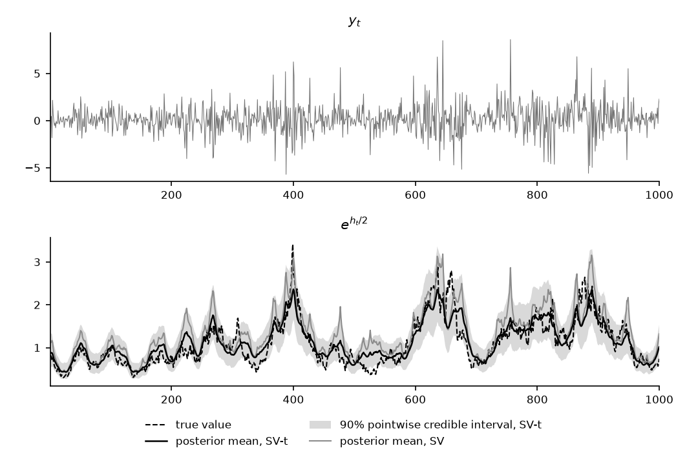
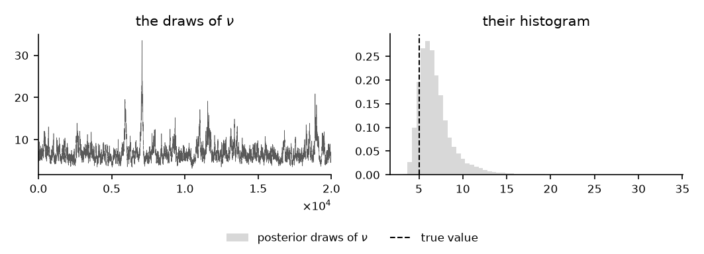

# How to Add Student-t Errors to a Stochastic Volatility Model

*Code: [`guide.py`](guide.py), with
[`ssm.ksc_ar1_mean`](../../src/statespace_toolkit/_ksc_ar1_mean.py),
[`ssm.nu_studentt`](../../src/statespace_toolkit/_nu_studentt.py),
[`ssm.sv_params`](../../src/statespace_toolkit/_sv_params.py),
[`ssm.inefficiency_factor`](../../src/statespace_toolkit/_inefficiency_factor.py) and
[`ssm.armh`](../../src/statespace_toolkit/_armh.py). Method:
[Chan and Grant (2016)](https://github.com/joshuaccchan/statespace-toolkit/blob/main/CITING.md#chan-and-grant-2016b),
[Kim, Shephard and Chib (1998)](https://github.com/joshuaccchan/statespace-toolkit/blob/main/CITING.md#kim-shephard-and-chib-1998)
and [Chan (2027)](https://github.com/joshuaccchan/statespace-toolkit/blob/main/CITING.md#chan-2027).
MATLAB version:
[the same guide in statespace-toolkit](https://github.com/joshuaccchan/statespace-toolkit/tree/main/guides/sv_t).*

In the stochastic volatility (SV) model of the first two guides, the errors are normal, so a large
observation can only come from a high volatility. With Student-$`t`$ errors, it can also come from
the tail of the error distribution. We add Student-$`t`$ errors to the sampler of
[How to Estimate a Stochastic Volatility Model by Gibbs Sampling](../sv_gibbs/). The new model,
SV-$`t`$, needs two new blocks: a latent scale for each period and the degrees of freedom. On data
with Student-$`t`$ errors, SV-$`t`$ estimates the volatility more accurately than the SV model.

To print the numbers and draw the figures first, run from the root of the repository, after
`pip install -e .`:

```
python guides/sv_t/guide.py
```

It takes about 45 seconds on the machine that produced this page.

## The SV-t Model

The model is

```math
y_t = \mu + \sqrt{\lambda_t}\,\mathrm{e}^{h_t/2}\varepsilon_t, \qquad \varepsilon_t \sim \mathcal{N}(0, 1), \qquad \lambda_t \sim \mathcal{IG}(\nu/2, \nu/2),
```

with the log-volatility $`h_t`$ of the first guide. Given $`h_t`$, the error
$`(y_t - \mu)\mathrm{e}^{-h_t/2}`$ is a normal variable whose variance $`\lambda_t`$ is drawn from
$`\mathcal{IG}(\nu/2, \nu/2)`$. Its distribution is therefore the Student-$`t`$ distribution
$`\mathcal{T}_\nu`$ with $`\nu`$ degrees of freedom. A small $`\nu`$ gives heavy tails, and as
$`\nu`$ grows the model approaches the SV model. Writing the errors as a scale mixture of normals
keeps the model Gaussian given $`\boldsymbol{\lambda} = (\lambda_1, \ldots, \lambda_T)'`$.

The priors of $`\mu`$, $`\mu_h`$, $`\phi`$ and $`\sigma_h^2`$ are those of the second guide. As in
Chan and Grant (2016), the prior of $`\nu`$ is uniform, $`\nu \sim \mathcal{U}(2, 100)`$. We
generate the data from the log-volatilities and the errors $`\varepsilon_t`$ of the first guide,
with $`\lambda_t`$ drawn for $`\nu = 5`$. The volatility path is therefore the same as in the
first two guides, and only the tails of the errors differ.

## Step 1: Add Two Blocks

The sampler of the second guide cycles through five blocks. SV-$`t`$ keeps them and adds the
scales $`\boldsymbol{\lambda}`$ and the degrees of freedom $`\nu`$:

1. $`(\mu \mid \mathbf{y}, \mathbf{h}, \boldsymbol{\lambda})`$, a normal distribution;
2. the indicators $`\mathbf{s}`$ and then $`\mathbf{h}`$, by the mixture step of the first guide;
3. $`(\boldsymbol{\lambda} \mid \mathbf{y}, \mu, \mathbf{h}, \nu)`$, independent inverse-gamma
   distributions;
4. $`(\nu \mid \boldsymbol{\lambda})`$, by a Metropolis-Hastings step;
5. $`\sigma_h^2`$, $`\phi`$ and $`\mu_h`$ given $`\mathbf{h}`$, as in the second guide.

The parameters of the log-volatility depend only on $`\mathbf{h}`$, so their blocks do not change.

## Step 2: Derive the New Conditional Distributions

**The mean and the log-volatilities.** Given $`\boldsymbol{\lambda}`$, the variance of $`y_t`$
given $`h_t`$ is $`\lambda_t\mathrm{e}^{h_t}`$. The mean is again a regression on a constant with
known variances:

```math
(\mu \mid \mathbf{y}, \mathbf{h}, \boldsymbol{\lambda}) \sim \mathcal{N}\big(K_\mu^{-1}c_\mu,\; K_\mu^{-1}\big), \qquad K_\mu = \frac{1}{V_\mu} + \sum_{t=1}^{T}\frac{1}{\lambda_t\mathrm{e}^{h_t}}, \qquad c_\mu = \frac{\mu_0}{V_\mu} + \sum_{t=1}^{T}\frac{y_t}{\lambda_t\mathrm{e}^{h_t}}.
```

The rescaled observation $`(y_t - \mu)/\sqrt{\lambda_t} = \mathrm{e}^{h_t/2}\varepsilon_t`$
follows the SV model of the first guide. The mixture step therefore applies to
$`y_t^* = \log\big((y_t - \mu)^2/\lambda_t + c\big)`$.

**The scales.** Given $`y_t`$, $`\mu`$, $`h_t`$ and $`\nu`$, each $`\lambda_t`$ depends on its own
period only, and the inverse-gamma prior is conjugate:

```math
(\lambda_t \mid y_t, \mu, h_t, \nu) \sim \mathcal{IG}\Big(\frac{\nu + 1}{2},\; \frac{\nu + (y_t - \mu)^2\mathrm{e}^{-h_t}}{2}\Big).
```

A large squared error relative to $`\mathrm{e}^{h_t}`$ gives a large $`\lambda_t`$.

**The degrees of freedom.** Given $`\boldsymbol{\lambda}`$, the log density of $`\nu`$ is

```math
\log p(\nu \mid \boldsymbol{\lambda}) = T\Big(\frac{\nu}{2}\log\frac{\nu}{2} - \log\Gamma\Big(\frac{\nu}{2}\Big)\Big) - \Big(\frac{\nu}{2} + 1\Big)\sum_{t=1}^{T}\log\lambda_t - \frac{\nu}{2}\sum_{t=1}^{T}\frac{1}{\lambda_t} + \text{const}
```

on $`(2, 100)`$. It has no standard form. A Metropolis-Hastings step proposes
$`\nu^* \sim \mathcal{N}(\hat{\nu}, K_\nu^{-1})`$, where $`\hat{\nu}`$ is the mode and $`K_\nu`$
the negative second derivative there. Its gradient and negative second derivative are

```math
\frac{T}{2}\Big(\log\frac{\nu}{2} + 1 - \psi\Big(\frac{\nu}{2}\Big)\Big) - \frac{1}{2}\sum_{t=1}^{T}\Big(\log\lambda_t + \frac{1}{\lambda_t}\Big) \qquad\text{and}\qquad \frac{T}{4}\psi'\Big(\frac{\nu}{2}\Big) - \frac{T}{2\nu},
```

where $`\psi`$ is the digamma function.
[`ssm.nu_studentt`](../../src/statespace_toolkit/_nu_studentt.py) takes this step: it finds the
mode by Newton's method, draws the candidate and accepts it with probability

```math
\min\Big\{1,\; \frac{p(\nu^* \mid \boldsymbol{\lambda})\, f_{\mathcal{N}}(\nu;\, \hat{\nu}, K_\nu^{-1})}{p(\nu \mid \boldsymbol{\lambda})\, f_{\mathcal{N}}(\nu^*;\, \hat{\nu}, K_\nu^{-1})}\Big\},
```

and rejected outside $`(2, 100)`$.

## Step 3: Write the Loop

```python
import numpy as np
import statespace_toolkit as ssm

mu0, Vmu = 0.0, 10.0                                # mu ~ N(mu0, Vmu)
muh0, Vmuh = 1.0, 10.0                              # mu_h ~ N(muh0, Vmuh)
phi0, Vphi = .97, .1**2                             # phi ~ TN(phi0, Vphi) on (-1, 1)
nuh, Sh = 5.0, .16                                  # sigma_h^2 ~ IG(nuh, Sh)
# the priors of sigma_h^2, phi and mu_h, with the keys of ssm.sv_params
hyp = dict(nuh=nuh, Sh=Sh, phi0=phi0, Vphi=Vphi, mu0=muh0, Vmu=Vmuh)
nuub = 100                                          # nu ~ U(2, nuub)
offset = 1e-4
nsim, burnin = 20000, 1000
muh, phi, sig2h, nu = np.log(y.var(ddof=1)), .98, .04, 5.0   # starting values
h = muh * np.ones(T)
lam = np.ones(T)
store_theta = np.zeros((nsim, 5))
nacc = 0
store_h = np.zeros((T, nsim // 10))
store_lam = np.zeros(T)
for isim in range(burnin + nsim):
    w = 1 / (lam * np.exp(h))                       # 1/(lambda_t e^{h_t})
    Kmu = 1 / Vmu + np.sum(w)                       # K_mu = 1/V_mu + sum_t 1/(lambda_t e^{h_t})
    mu = (mu0 / Vmu + w @ y) / Kmu + rng.standard_normal() / np.sqrt(Kmu)

    ystar = np.log((y - mu)**2 / lam + offset)      # y*_t = log((y_t - mu)^2/lambda_t + c)
    h, _ = ssm.ksc_ar1_mean(ystar, h, muh, phi, sig2h, rng=rng)

    e2 = (y - mu)**2 * np.exp(-h)                   # lambda_t ~ IG((nu + 1)/2, (nu + e2_t)/2)
    lam = 1 / rng.gamma((nu + 1) / 2, 2 / (nu + e2))

    nu, acc, _ = ssm.nu_studentt(lam, nu, nuub, rng=rng)   # nu given lambda
    nacc += acc * (isim >= burnin)

    [muh], [phi], [sig2h], _ = ssm.sv_params(h, muh, phi, hyp, 1, rng=rng)   # guides/sv_gibbs

    if isim >= burnin:
        store_theta[isim - burnin] = mu, muh, phi, sig2h, nu
        store_lam = store_lam + lam / nsim
        if (isim - burnin + 1) % 10 == 0:
            store_h[:, (isim - burnin + 1) // 10 - 1] = h
```

[`ssm.sv_params`](../../src/statespace_toolkit/_sv_params.py) takes the blocks of $`\sigma_h^2`$,
$`\phi`$ and $`\mu_h`$, as in the second guide. The chain starts from
$`\boldsymbol{\lambda} = \mathbf{1}`$ and $`\nu = 5`$, and from the starting values of the second
guide for the other blocks.

## Step 4: See What the Student-t Errors Change

The table compares SV-$`t`$ with the SV model of the second guide on the same data.

| | True value | SV-$`t`$: posterior mean | 90% interval | Inefficiency factor | SV: posterior mean | 90% interval |
|---|---|---|---|---|---|---|
| $`\mu`$ | 0.1 | 0.1189 | (0.0670, 0.1704) | 1.9 | 0.1220 | (0.0695, 0.1744) |
| $`\mu_h`$ | 0 | 0.0331 | (-0.3721, 0.4348) | 9.0 | 0.3025 | (-0.0128, 0.6213) |
| $`\phi`$ | 0.97 | 0.9624 | (0.9375, 0.9827) | 50.4 | 0.9371 | (0.9028, 0.9650) |
| $`\sigma_h^2`$ | 0.04 | 0.0627 | (0.0339, 0.1055) | 96.2 | 0.1267 | (0.0769, 0.1954) |
| $`\nu`$ | 5 | 6.93 | (4.61, 10.98) | 112.5 | | |

We note three results. First, the posterior of $`\nu`$ covers its true value of 5: its median is
6.45 and its 90 percent interval is (4.61, 10.98). Second, under the SV model the outliers raise
the estimated volatility. Its posterior mean of $`\sigma_h^2`$ is 3.2 times the true value, and
the true value lies below its 90 percent interval. Its posterior mean of $`\phi`$ falls to 0.94.
Under SV-$`t`$ both true values lie inside the intervals. Third, the volatility estimated by
SV-$`t`$ is closer to the truth (Figure 1). The root mean squared error of the posterior mean of
$`\mathrm{e}^{h_t/2}`$ is 0.257, against 0.390 under SV. The 90 percent intervals of SV-$`t`$
contain the true volatility in 904 of the 1,000 periods.

The five periods with the largest $`\lambda_t`$ show the mechanism:

| Period | True $`\lambda_t`$ | Posterior mean of $`\lambda_t`$ | True $`\lvert\varepsilon_t\rvert`$ | True $`\mathrm{e}^{h_t/2}`$ | SV-$`t`$ | SV |
|---|---|---|---|---|---|---|
| 526 | 30.68 | 5.31 | 1.82 | 0.37 | 0.89 | 1.40 |
| 755 | 20.49 | 1.27 | 0.15 | 1.54 | 1.64 | 2.50 |
| 756 | 19.55 | 7.04 | 1.28 | 1.50 | 1.69 | 2.87 |
| 650 | 15.46 | 1.27 | 0.14 | 1.85 | 1.59 | 1.67 |
| 676 | 14.50 | 2.85 | 1.15 | 1.20 | 1.92 | 2.50 |

In period 526, the error $`\sqrt{\lambda_t}\varepsilon_t`$ is 10.1 times the volatility. SV puts
the volatility at 1.40, about 3.8 times its true value of 0.37, while SV-$`t`$ puts it at 0.89 and
gives $`\lambda_t`$ a posterior mean of 5.31. A large $`\lambda_t`$ produces a large observation
only when $`\varepsilon_t`$ is not small. In periods 650 and 755, $`|\varepsilon_t|`$ is 0.14 and
0.15, so the data carry little information about $`\lambda_t`$, and its posterior mean stays near
1.



*Figure 1: SV-$`t`$ and SV on data generated with Student-$`t`$ errors, $`\nu = 5`$, and the
log-volatilities of the first guide. Top, the data. Bottom, the true volatility
$`\mathrm{e}^{h_t/2}`$, its posterior means under SV-$`t`$ and SV, and the 90 percent pointwise
credible intervals of SV-$`t`$.*



*Figure 2: The 20,000 draws of $`\nu`$ kept after the burn-in, and their histogram.*

The draws of $`\phi`$, $`\sigma_h^2`$ and $`\nu`$ are the most autocorrelated. With Bartlett
weights up to lag 400, their inefficiency factors are 50.4, 96.2 and 112.5. The 20,000 draws thus
carry the information of about 180 to 400 independent draws. Geweke's Z with $`L = 400`$ is
$`-1.53`$, 0.62, $`-0.04`$, $`-0.11`$ and $`-0.02`$ for the five parameters, all inside
$`\pm 1.96`$. The candidate $`\nu^*`$ is accepted in 98 percent of the iterations.

## How We Check It

<details>
<summary>The posterior from a second sampler, which draws the log-volatilities from their exact
conditional distribution</summary>

The sampler of Chan and Grant (2016) for SV-$`t`$ has the same blocks, except for $`\mathbf{h}`$.
It draws $`\mathbf{h}`$ from its exact conditional distribution given $`\boldsymbol{\lambda}`$, by
the accept-reject Metropolis-Hastings step of
[How to Draw the Log-Volatilities of a Stochastic Volatility Model](../sv_states/). `guide.py`
runs it on the same data with the same priors, for 10,000 draws after a burn-in of 1,000, starting
the log-volatilities at the mode. Its Metropolis-Hastings step takes the candidate path in 52.3
percent of the iterations.

The posterior means of the two samplers differ by $`-0.5`$, $`-2.3`$, 1.1, $`-0.7`$ and $`-1.7`$
Monte Carlo standard errors for $`\mu`$, $`\mu_h`$, $`\phi`$, $`\sigma_h^2`$ and $`\nu`$.

</details>

## Adapt It Yourself

Student-$`t`$ errors give every period a scale of its own. Some models let only a few periods have
outliers: $`\lambda_t = \kappa`$ with probability $`p`$ and $`\lambda_t = 1`$ otherwise, with a
known $`\kappa > 1`$ and the prior $`p \sim \mathcal{B}(a_p, b_p)`$. Which blocks change?

<details>
<summary>Answer</summary>

The block of $`\nu`$ goes, $`p`$ gets a block of its own, and the scales become two-point draws.
Let $`e_t^2 = (y_t - \mu)^2\mathrm{e}^{-h_t}`$. Given $`y_t`$, $`\mu`$, $`h_t`$ and $`p`$, the
probability that period $`t`$ has an outlier is

$`\displaystyle \Pr(\lambda_t = \kappa \mid y_t, \mu, h_t, p) = \frac{p\,\kappa^{-1/2}\exp(-e_t^2/(2\kappa))}{p\,\kappa^{-1/2}\exp(-e_t^2/(2\kappa)) + (1 - p)\exp(-e_t^2/2)},`$

the ratio of the two normal densities of $`y_t`$, with variances $`\kappa\mathrm{e}^{h_t}`$ and
$`\mathrm{e}^{h_t}`$. Given the scales, the number of outliers $`n_{\text{out}}`$ is a binomial
draw, so the beta prior is conjugate:
$`(p \mid \boldsymbol{\lambda}) \sim \mathcal{B}(a_p + n_{\text{out}}, b_p + T - n_{\text{out}})`$.
With the settings

```python
kap = 10.0             # lambda_t = kap with probability p, else 1
ap, bp = 1.0, 19.0     # p ~ B(ap, bp)
```

these lines replace the blocks of $`\boldsymbol{\lambda}`$ and $`\nu`$ in the loop:

```python
    e2 = (y - mu)**2 * np.exp(-h)                   # Pr(lambda_t = kap) given y_t, mu, h_t, p
    a1 = p / np.sqrt(kap) * np.exp(-e2 / (2 * kap))
    a0 = (1 - p) * np.exp(-e2 / 2)
    lam = 1 + (kap - 1) * (rng.random(T) < a1 / (a1 + a0))
    nout = np.sum(lam > 1)
    p = rng.beta(ap + nout, bp + T - nout)          # p ~ B(ap + n_out, bp + T - n_out)
```

`guide.py` runs this sampler on the data of this guide, with $`\kappa = 10`$ and
$`p \sim \mathcal{B}(1, 19)`$. It checks the outlier probability against the two normal densities
it comes from, and the two agree to within 3e-16. The posterior mean of $`p`$ is 0.047, with 90
percent interval (0.019, 0.083). Fourteen periods have an outlier probability above 0.5, and
three of them are among the ten largest true errors $`\sqrt{\lambda_t}\varepsilon_t`$. The
posterior mean of $`\sigma_h^2`$ is 0.0730, between 0.0627 under SV-$`t`$ and 0.1267 under SV.
With $`\kappa`$ fixed, only the largest errors enter the outlier component, and the others raise
the estimated volatility.

</details>

## Next

[How to Compare Stochastic Volatility Models by the Marginal Likelihood](../sv_compare/) compares
a constant variance, SV and SV-$`t`$ by their marginal likelihoods. Among the examples of the
MATLAB toolkit,
[ex08](https://github.com/joshuaccchan/statespace-toolkit/blob/main/examples/ex08_sv_ma_t.m) adds
an MA(1) term to SV-$`t`$ and estimates it on daily silver returns.

## Using This Method in Your Research

The model and its priors are those of Chan and Grant (2016). The sampler draws the
log-volatilities by the auxiliary mixture sampler of Kim, Shephard and Chib (1998), and Chan
(2027) gives the textbook treatment of the model.
[`CITING.md`](https://github.com/joshuaccchan/statespace-toolkit/blob/main/CITING.md) lists the
paper behind each function of the toolkit and how to cite the toolkit itself.

## References

Chan, J. C. C. (2027). *Bayesian Macroeconometrics: Methods and Applications*. Chapman &
Hall/CRC. [Code repository](https://github.com/joshuaccchan/bayesian-macroeconometrics)

Chan, J. C. C. and Grant, A. L. (2016). Modeling Energy Price Dynamics: GARCH versus Stochastic
Volatility. *Energy Economics*, 54: 182-189.
[doi:10.1016/j.eneco.2015.12.003](https://doi.org/10.1016/j.eneco.2015.12.003)

Kim, S., Shephard, N. and Chib, S. (1998). Stochastic Volatility: Likelihood Inference and
Comparison with ARCH Models. *Review of Economic Studies*, 65(3): 361-393.
[doi:10.1111/1467-937X.00050](https://doi.org/10.1111/1467-937X.00050)
