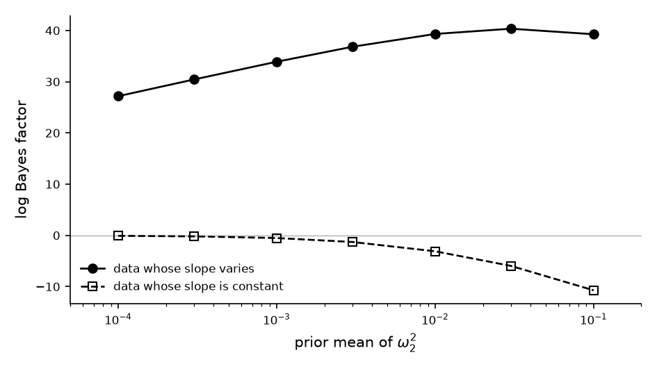

# How to Tell Whether a Coefficient Varies over Time

*Code: [`guide.py`](guide.py), with [`ssm.intlike`](../../src/statespace_toolkit/_intlike.py),
[`ssm.surform`](../../src/statespace_toolkit/_surform.py) and
[`ssm.diffmat`](../../src/statespace_toolkit/_diffmat.py). Method:
[Chan and Eisenstat (2015)](https://github.com/joshuaccchan/statespace-toolkit/blob/main/CITING.md#chan-and-eisenstat-2015),
[Chan and Jeliazkov (2009)](https://github.com/joshuaccchan/statespace-toolkit/blob/main/CITING.md#chan-and-jeliazkov-2009)
and [Chan (2027)](https://github.com/joshuaccchan/statespace-toolkit/blob/main/CITING.md#chan-2027).
MATLAB version:
[the same guide in statespace-toolkit](https://github.com/joshuaccchan/statespace-toolkit/tree/main/guides/tvp_compare).*

We use marginal likelihoods to assess whether the coefficients of a time-varying parameter (TVP)
regression vary over time. We compare four regressions with an intercept and one regressor:
neither coefficient varies, only the intercept varies, only the slope varies, or both vary. Each
model is estimated using a Metropolis-Hastings sampler that draws the variances from their
posterior, using [`ssm.intlike`](../../src/statespace_toolkit/_intlike.py) to evaluate the
integrated likelihood. Given the posterior draws of the variances, we then use importance sampling
to compute the marginal likelihood.

On data whose intercept and slope both vary, the model in which both vary has the largest marginal
likelihood. On data whose slope is constant, the model in which only the intercept varies has the
largest. The evidence for a constant slope grows with the prior mean of the slope's variance.

To print the numbers and draw the figure first, run from the root of the repository, after
`pip install -e .`:

```
python guides/tvp_compare/guide.py
```

It takes about six minutes on the machine that produced this page.

## The Four Models

Each model is a TVP regression in which each coefficient either follows a random walk or stays
constant. A coefficient that varies follows a random walk,
$`\beta_{it} = \beta_{i,t-1} + \eta_{it}`$ with $`\eta_{it} \sim \mathcal{N}(0, \omega_i^2)`$,
from the initial value $`\beta_{i0} \sim \mathcal{N}(0, 100)`$. A coefficient that is constant has
$`\beta_{it} = \beta_i`$ in every period. We assume the same prior for it,
$`\beta_i \sim \mathcal{N}(0, 100)`$, so that the models differ only in whether a coefficient
moves. The variances have the priors of
[How to Estimate a TVP Regression by Gibbs Sampling](../tvp_gibbs/),
$`\sigma^2 \sim \mathcal{IG}(3, 2)`$ and $`\omega_i^2 \sim \mathcal{IG}(3, 0.02)`$, with prior
means 1 and 0.01. The models differ in their unknown variances:

| Coefficients that vary | Intercept | Slope | Variances |
|---|---|---|---|
| None | constant | constant | $`\sigma^2`$ |
| Intercept | random walk | constant | $`\sigma^2`$, $`\omega_1^2`$ |
| Slope | constant | random walk | $`\sigma^2`$, $`\omega_2^2`$ |
| Both | random walk | random walk | $`\sigma^2`$, $`\omega_1^2`$, $`\omega_2^2`$ |

We use two data sets with the same regressor $`x_t`$, each with $`T = 200`$,
$`\mathbf{x}_t = (1, x_t)'`$ and $`\sigma^2 = 1`$. The first is the data of
[How to Draw Time-Varying Regression Coefficients](../tvp_states/), whose coefficients both vary,
with $`\boldsymbol{\Omega} = \mathrm{diag}(0.005, 0.02)`$. The second is the data of Adapt It
Yourself in [How to Estimate a TVP Regression by Gibbs Sampling](../tvp_gibbs/). Its intercept
varies with $`\omega_1^2 = 0.005`$, and its slope is constant at 1.

## Step 1: Integrate the Coefficients Out

Given the variances, each model is a linear Gaussian state space model in its coefficients.
[`ssm.intlike`](../../src/statespace_toolkit/_intlike.py) then returns the integrated likelihood
$`p(\mathbf{y} \mid \boldsymbol{\theta})`$, where $`\boldsymbol{\theta}`$ holds the variances of
the model. As in Step 3 of
[How to Compute the Integrated Likelihood of a State Space Model](../integrated_likelihood/), the
initial values move into the states. Let $`\boldsymbol{\gamma}_t`$ hold the coefficients that
vary, in period $`t`$, and $`\boldsymbol{\delta}`$ those that are constant. The states are

```math
\boldsymbol{\alpha} = (\boldsymbol{\gamma}_0', \boldsymbol{\gamma}_1', \ldots, \boldsymbol{\gamma}_T', \boldsymbol{\delta}')'.
```

The measurement equation is
$`\mathbf{y} = \mathbf{Z}\boldsymbol{\alpha} + \boldsymbol{\varepsilon}`$. The first block of
columns of $`\mathbf{Z}`$ is zero, since $`\boldsymbol{\gamma}_0`$ does not enter the measurement
equation. The second block is the stacked design matrix of the first guide, built from the
regressors whose coefficients vary. The third block holds the regressors whose coefficients are
constant.

The prior of $`\boldsymbol{\alpha}`$ has mean $`\mathbf{b} = \mathbf{0}`$. Its precision matrix is
linear in the inverse variances,

```math
\mathbf{P} = \mathbf{A}_0 + \sum_{i} \frac{1}{\omega_i^2}\mathbf{A}_i,
```

where the sum runs over the coefficients that vary. $`\mathbf{A}_0`$ comes from the priors of
$`\boldsymbol{\gamma}_0`$ and $`\boldsymbol{\delta}`$, and $`\mathbf{A}_i/\omega_i^2`$ from the
random walk of coefficient $`i`$. `model_matrices` builds $`\mathbf{Z}`$, $`\mathbf{b}`$ and these
matrices once per model. Each new value of the variances then costs a few sparse additions:

```python
import numpy as np
import scipy.sparse as sp
from scipy.special import gammaln
import statespace_toolkit as ssm


def model_matrices(X, V, V0):
    """the stacked design Z, prior mean b and prior precision P(iom) of the regression whose
    coefficients V follow random walks from beta_i0 ~ N(0, V0) and whose others are constant
    with the prior N(0, V0); the states are (beta_V0', beta_V1', ..., beta_VT', beta_C')',
    and iom holds 1/omega_i^2 for i in V"""
    T, k = X.shape
    C = [i for i in range(k) if i not in V]
    kv, kc = len(V), len(C)
    if kv > 0:
        # the first differences of the paths
        G = sp.kron(ssm.diffmat(T + 1), sp.eye_array(kv), format='csc')
        A0 = G.T @ sp.diags_array(np.r_[np.ones(kv) / V0, np.zeros(kv * T)]) @ G
        Ai = []
        for i in range(kv):
            sel = np.r_[np.zeros(kv), np.tile((np.arange(kv) == i).astype(float), T)]
            Ai.append(sp.block_diag([G.T @ sp.diags_array(sel) @ G, sp.csc_array((kc, kc))],
                                    format='csc'))
        Zv = sp.hstack([sp.csc_array((T, kv)), ssm.surform(X[:, V])], format='csc')
    else:
        A0, Ai, Zv = sp.csc_array((0, 0)), [], sp.csc_array((T, 0))
    A0 = sp.block_diag([A0, sp.eye_array(kc) / V0], format='csc')
    M = ssm.Struct()
    M.Z = sp.hstack([Zv, sp.csc_array(X[:, C])], format='csc')
    M.b = np.zeros(A0.shape[0])
    M.P = lambda iom: prior_precision(A0, Ai, iom)
    return M


def prior_precision(A0, Ai, iom):
    """A0 + sum_i Ai[i] iom[i]"""
    P = A0
    for i in range(len(Ai)):
        P = P + Ai[i] * iom[i]
    return P
```

Here `G` takes the first differences of the paths from period 0 to $`T`$, and `sel` picks the
differences of coefficient $`i`$.

The constant coefficients come last in $`\boldsymbol{\alpha}`$. They enter the measurement
equation in every period, so the last rows of
$`\mathbf{K} = \mathbf{P} + \mathbf{Z}'\mathbf{Z}/\sigma^2`$ link them to the coefficients of
every period. The rest of $`\mathbf{K}`$ is banded. `ssm.intlike` factors $`\mathbf{K}`$ in the
order of the states, and with this order the Cholesky factor stays sparse. When only the intercept
varies, it has 602 nonzero entries. With the constant slope first in $`\boldsymbol{\alpha}`$, it
has 20,303 of the 20,503 entries of its lower triangle.

## Step 2: Draw the Variances

Let $`\boldsymbol{\varphi}`$ hold the logs of the variances of a model: $`\log\sigma^2`$, then
$`\log\omega_i^2`$ for each coefficient that varies. Up to a constant, its log posterior density
is

```math
\log f(\boldsymbol{\varphi}) = \log p(\mathbf{y} \mid \boldsymbol{\theta}) + \log p(\boldsymbol{\theta}) + \sum_j \varphi_j,
```

where the last term is the log Jacobian of $`\boldsymbol{\theta} = \exp(\boldsymbol{\varphi})`$.
In the code, `lp` evaluates $`\log f`$, and `logig` is the log density of the inverse-gamma
distribution. `draw_variances` draws $`\boldsymbol{\varphi}`$ with the sampler of Step 4 of
[How to Compute the Integrated Likelihood of a State Space Model](../integrated_likelihood/),
written as a function. It is an independence-chain Metropolis-Hastings sampler. Its proposal is a
t distribution with 5 degrees of freedom. The proposal is located at the mode of `lp` and scaled
by the inverse of the negative Hessian of `lp` there. The loop runs all four models on both data
sets:

```python
nu_sig, S_sig = 3, 2                            # sig2 ~ IG(nu_sig, S_sig)
nu_om, S_om = 3, np.array([.02, .02])           # omega_i^2 ~ IG(nu_om, S_om[i])
V0 = 100                                        # beta_i0 ~ N(0, V0), constant beta_i too


def logig(x, nu, S):
    """the log density of the inverse-gamma distribution IG(nu, S) at x"""
    return nu * np.log(S) - gammaln(nu) - (nu + 1) * np.log(x) - S / x


vary = [[], [0], [1], [0, 1]]                   # the coefficients that vary, by model
mnames = ['none', 'intercept', 'slope', 'both']
nsim, burnin, R = 5000, 500, 10000
lml, nse, acc = np.zeros((4, 2)), np.zeros((4, 2)), np.zeros((4, 2))
draws, LP = {}, {}
for d in range(2):
    for m in range(4):
        M = model_matrices(X, vary[m], V0)

        # log p(y | theta) + log p(theta) + the Jacobian, at phi = (log sig2, log omega_i^2);
        # the defaults keep y, M and v at their values in this pass of the loop
        def lp(phi, y=Y[d], M=M, v=vary[m]):
            iR = sp.eye_array(T) * np.exp(-phi[0])
            return (ssm.intlike(y, M.Z, iR, M.P(np.exp(-phi[1:])), M.b)[0]
                    + logig(np.exp(phi[0]), nu_sig, S_sig)
                    + np.sum(logig(np.exp(phi[1:]), nu_om, S_om[v])) + np.sum(phi))

        draws[m, d], acc[m, d] = draw_variances(lp, 1 + len(vary[m]), nsim, burnin, rng)
        lml[m, d], nse[m, d] = is_logml(lp, draws[m, d], R, rng)
        LP[m, d] = lp
```

Each chain keeps 5,000 draws after a burn-in of 500. The acceptance rates lie between 0.80 and
0.93, so each proposal is close to its posterior.

## Step 3: Estimate the Marginal Likelihoods by Importance Sampling

The marginal likelihood of a model averages the integrated likelihood over the prior of the
variances:

```math
p(\mathbf{y}) = \int p(\mathbf{y} \mid \boldsymbol{\theta})\,p(\boldsymbol{\theta})\,d\boldsymbol{\theta} = \int f(\boldsymbol{\varphi})\,d\boldsymbol{\varphi}.
```

Importance sampling draws $`\boldsymbol{\varphi}^{(1)}, \ldots, \boldsymbol{\varphi}^{(R)}`$ from
a density $`g`$ and averages the weights $`f/g`$:

```math
\hat{p}(\mathbf{y}) = \frac{1}{R}\sum_{r=1}^{R} \frac{f(\boldsymbol{\varphi}^{(r)})}{g(\boldsymbol{\varphi}^{(r)})}.
```

The estimate is precise when $`g`$ is close to the posterior. The cross-entropy method of Chan and
Eisenstat (2015) chooses $`g`$ from a parametric family. It takes the member closest to the
posterior in Kullback-Leibler divergence. In practice, the method fits the family to the posterior
draws by maximum likelihood. For the normal family, the fit is the mean and covariance of the
draws. As in
[ex02](https://github.com/joshuaccchan/statespace-toolkit/blob/main/examples/ex02_integrated_likelihood.m),
$`g`$ is a t distribution with 5 degrees of freedom at that location and scale. Its heavier tails
keep the weights bounded.

`is_logml` takes $`R = 10{,}000`$ draws and works on the log scale. The numerical standard error
comes from 20 batches of 500 draws. It is the standard deviation of the 20 batch estimates of
$`\log p(\mathbf{y})`$, divided by $`\sqrt{20}`$:

```python
def is_logml(lp, draws, R, rng):
    """log p(y) by importance sampling. The importance density is a t with 5 degrees of freedom
    at the mean and covariance of the posterior draws: the cross-entropy fit of a normal
    density (Chan and Eisenstat, 2015), with heavier tails. R is a multiple of 20, and the
    numerical standard error comes from 20 batches."""
    nu, d = 5, draws.shape[1]
    m, C = draws.mean(axis=0), np.linalg.cholesky(np.atleast_2d(np.cov(draws, rowvar=False)))
    z = rng.standard_normal((d, R)) / np.sqrt(rng.chisquare(nu, R) / nu)
    phi = m[:, None] + C @ z
    lconst = (gammaln((nu + d) / 2) - gammaln(nu / 2) - d / 2 * np.log(nu * np.pi)
              - np.sum(np.log(np.diag(C))))
    logw = np.zeros(R)
    for r in range(R):                                     # log p(y, theta) - log g(phi)
        logw[r] = lp(phi[:, r]) - (lconst - (nu + d) / 2 * np.log(1 + z[:, r] @ z[:, r] / nu))
    lml = logmeanexp(logw)
    lb, wb = np.zeros(20), logw.reshape(20, R // 20)       # row b of wb: batch b
    for b in range(20):
        lb[b] = logmeanexp(wb[b])
    nse = np.std(lb, ddof=1) / np.sqrt(20)
    return lml, nse
```

`logmeanexp` computes the log of a mean of exponentials without overflow.

## Step 4: Compare the Models

The log Bayes factor of one model against another is the difference of their log marginal
likelihoods. The table gives the log marginal likelihoods, with numerical standard errors in
parentheses and the largest of each column in bold:

| Coefficients that vary | Data whose slope varies | Data whose slope is constant |
|---|---|---|
| None | -344.38 (0.002) | -318.89 (0.002) |
| Intercept | -343.29 (0.002) | **-296.41** (0.003) |
| Slope | -311.29 (0.003) | -321.67 (0.003) |
| Both | **-303.97** (0.004) | -299.52 (0.004) |

On the data whose slope varies, the model in which both vary has the largest marginal likelihood.
Holding either coefficient constant lowers the log marginal likelihood by at least 7.3. On the
data whose slope is constant, the model in which only the intercept varies has the largest. The
model in which both vary comes second, 3.1 lower, a Bayes factor of about 22. The two models
with a constant intercept are 22.5 and 25.3 lower. These differences are far larger than the
numerical standard errors, which are at most 0.004.

The model in which both vary contains the model in which only the intercept varies as the limit
$`\omega_2^2 \to 0`$. Its marginal likelihood averages the fit over the prior of $`\omega_2^2`$.
That prior has mean 0.01 and puts almost no mass below 0.001. With $`\omega_2^2 = 0.01`$, the
change of the slope over 200 periods has standard deviation
$`\sqrt{200 \times 0.01} \approx 1.4`$. The data show no such change, so these values of
$`\omega_2^2`$ lower the average fit. The same prior keeps the posterior of $`\omega_2^2`$ away
from zero.

## Step 5: Vary the Prior of the Slope's Variance

A Bayes factor is sensitive to the prior of a parameter that one model has and the other lacks.
Here that parameter is $`\omega_2^2`$. We recompute the log Bayes factor of the model in which
both vary against the model in which only the intercept varies. The prior mean of $`\omega_2^2`$
ranges from 0.0001 to 0.1. The shape stays at 3, so the scale `S2` is twice the prior mean. Only
the prior of $`\omega_2^2`$ in `lp` changes:

```python
S2 = 2 * pmean[p]

def lp(phi, y=Y[d], M=M, S2=S2):
    iR = sp.eye_array(T) * np.exp(-phi[0])
    return (ssm.intlike(y, M.Z, iR, M.P(np.exp(-phi[1:])), M.b)[0]
            + logig(np.exp(phi[0]), nu_sig, S_sig)
            + logig(np.exp(phi[1]), nu_om, S_om[0]) + logig(np.exp(phi[2]), nu_om, S2)
            + np.sum(phi))
```

| Prior mean of $`\omega_2^2`$ | Data whose slope varies | Data whose slope is constant |
|---|---|---|
| 0.0001 | 27.18 (0.004) | -0.09 (0.005) |
| 0.0003 | 30.43 (0.004) | -0.19 (0.005) |
| 0.001 | 33.90 (0.005) | -0.52 (0.005) |
| 0.003 | 36.82 (0.004) | -1.29 (0.005) |
| 0.01 | 39.32 (0.004) | -3.11 (0.005) |
| 0.03 | 40.34 (0.004) | -5.95 (0.004) |
| 0.1 | 39.27 (0.005) | -10.73 (0.005) |

On the data whose slope varies, every prior mean favors the varying slope (Figure 1). The log
Bayes factor rises from 27.18 at a prior mean of 0.0001 to 40.34 at 0.03, and falls to 39.27 at
0.1. It is largest for prior means near the true variance, 0.02. A smaller prior mean concentrates
$`\omega_2^2`$ on values too small to track the slope. A larger one spreads the prior over
variances that the data rule out.

On the data whose slope is constant, no prior mean favors the varying slope. The log Bayes
factor stays within 0.52 of zero up to a prior mean of 0.001, and falls to -10.73 at 0.1. A
prior that concentrates $`\omega_2^2`$ near zero makes the two models predict alike. The data
then cannot separate them.

In applications, choose the prior of each $`\omega_i^2`$ from the movement of the coefficient that
you consider plausible. Over $`T`$ periods, a random walk with variance $`\omega^2`$ changes with
standard deviation $`\sqrt{T\omega^2}`$. Report the Bayes factor for a range of priors around that
choice.



*Figure 1: The log Bayes factor of the model in which both coefficients vary against the model in
which only the intercept varies. The horizontal axis gives the prior mean of $`\omega_2^2`$ on a
log scale. Solid, the data whose slope varies; dashed, the data whose slope is constant. A
positive value favors a varying slope.*

## How We Check It

<details>
<summary>The marginal likelihoods on a grid, and the dense normal density of y</summary>

The models have at most three variances, so a grid can compute each marginal likelihood without
simulation. `grid_logml` sums $`f(\boldsymbol{\varphi})`$ times the cell volume over a grid. The
grid spans 6 standard deviations of the draws on either side of their mean. It has 400 points for
one variance, 60 × 60 for two and 24 × 24 × 24 for three. The estimates by importance sampling
differ from the grid values by at most 0.008, or 3.1 numerical standard errors. The log Bayes
factors of Step 5 differ by at most 0.012.

The integrated likelihood also has a dense form. For a coefficient that varies,
$`\mathrm{Cov}(\beta_{it}, \beta_{is}) = 100 + \min(t, s)\,\omega_i^2`$; for a constant one, the
covariance is 100. Then $`\mathbf{y}`$ is normal with mean zero. The covariance of $`y_t`$ and
$`y_s`$ is the sum over $`i`$ of $`x_{it}x_{is}\mathrm{Cov}(\beta_{it}, \beta_{is})`$, plus
$`\sigma^2`$ when $`t = s`$. Here $`x_{it}`$ is entry $`i`$ of $`\mathbf{x}_t`$. `dense_loglike`
evaluates this density with the $`T \times T`$ covariance matrix. For each model and data set,
`ssm.intlike` agrees with it to within 9e-14 relative to the value, at the posterior mean of
$`\boldsymbol{\varphi}`$. The dense form does not use $`\mathbf{Z}`$ or $`\mathbf{P}`$, so the
agreement also checks `model_matrices`.

</details>

## Adapt It Yourself

With an intercept and two regressors, how many models are there, and what changes in the code of
Step 2?

<details>
<summary>Answer</summary>

Eight, one for each subset of the three coefficients. The binary digits of 0 to 7 list the
subsets, and the bit test `m >> i & 1` reads them:

```python
vary = [[i for i in range(k) if m >> i & 1] for m in range(2**k)]
```

The first subset is empty, and the last holds all three coefficients. `model_matrices` takes any
subset, so the rest of the code keeps its form. The loop and the arrays of results run over
`len(vary)` models, and `S_om` needs one scale per coefficient. `guide.py` builds the eight
models on data generated with three regressors. For each model, `ssm.intlike` agrees with the
dense normal density of $`\mathbf{y}`$ to within 4e-13 relative to the value. The number of models
doubles with each coefficient, and each model needs its own sampler and importance sampling run.

</details>

## Next

Among the examples of the MATLAB toolkit,
[ex02](https://github.com/joshuaccchan/statespace-toolkit/blob/main/examples/ex02_integrated_likelihood.m)
uses the same importance density to compare two models of US PCE inflation. The example
[ex03](https://github.com/joshuaccchan/statespace-toolkit/blob/main/examples/ex03_tvp_regression.m)
estimates a TVP Phillips curve for US PCE inflation, whose coefficients you can test in the same
way.
[`replications/chan_eisenstat2015_er_mlce`](https://github.com/joshuaccchan/statespace-toolkit/tree/main/replications/chan_eisenstat2015_er_mlce)
holds the code of Chan and Eisenstat (2015).

## Using This Method in Your Research

The marginal likelihoods follow Chan and Eisenstat (2015), who compare a VAR, a TVP-VAR and a
dynamic factor VAR by importance sampling. For the TVP-VAR, they integrate the time-varying
coefficients out. `ssm.intlike` evaluates the integrated likelihood by the method of Chan and
Jeliazkov (2009). Chan (2027) gives the textbook treatment of both.
[`CITING.md`](https://github.com/joshuaccchan/statespace-toolkit/blob/main/CITING.md) lists the
paper behind each function of the toolkit and how to cite the toolkit itself.

## References

Chan, J. C. C. (2027). *Bayesian Macroeconometrics: Methods and Applications*. Chapman &
Hall/CRC. [Code repository](https://github.com/joshuaccchan/bayesian-macroeconometrics)

Chan, J. C. C. and Eisenstat, E. (2015). Marginal Likelihood Estimation with the Cross-Entropy
Method. *Econometric Reviews*, 34(3): 256-285.
[doi:10.1080/07474938.2014.944474](https://doi.org/10.1080/07474938.2014.944474)

Chan, J. C. C. and Jeliazkov, I. (2009). Efficient Simulation and Integrated Likelihood Estimation
in State Space Models. *International Journal of Mathematical Modelling and Numerical
Optimisation*, 1(1/2): 101-120.
[doi:10.1504/IJMMNO.2009.030090](https://doi.org/10.1504/IJMMNO.2009.030090)
